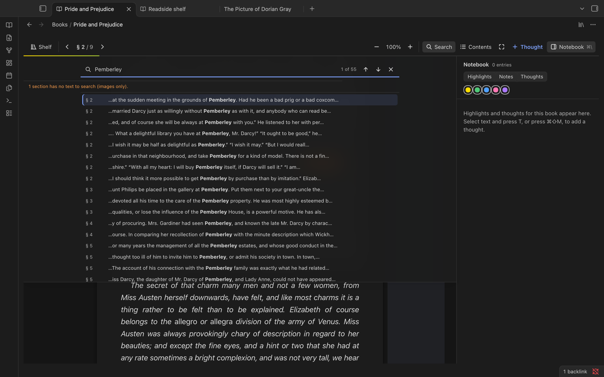
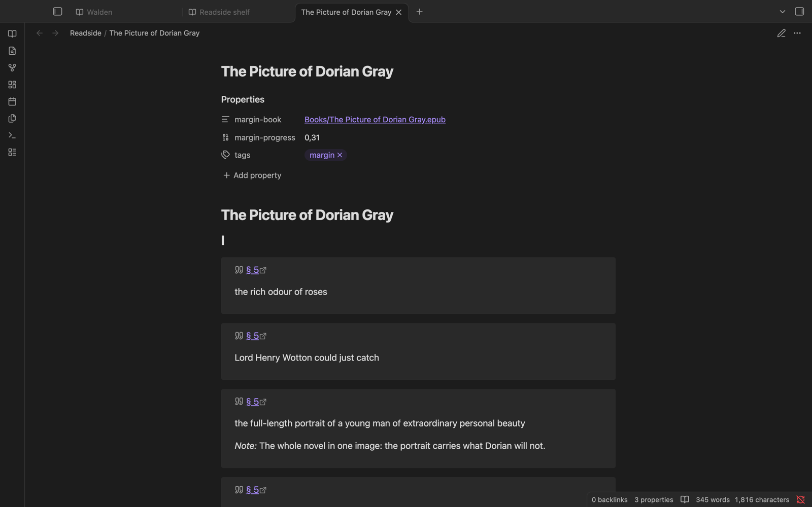
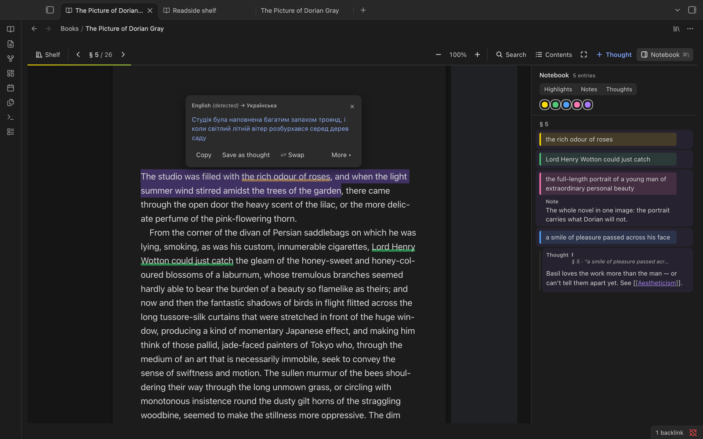

<h1 align="center">Readside</h1>

  <b>Read PDFs and EPUBs inside Obsidian, and keep what you think about them in your vault.</b> 
  Highlights, margin notes and thoughts, a notebook that lives as a Markdown note, and offline translation.

  
  
  
  

  

## Features

- 🖍️ **Highlight and underline** in five colours, add a note to any highlight, or write a thought in the margin.
- 📓 **A notebook for every book**: a side panel of everything you marked, filterable by kind and colour.
- ✍️ **A writing sheet for longer thoughts.** Press **⌘E** in a thought to write it at full size, with its highlight above, its links beside it, and Bold, Italic, Link and Quote buttons. Type `#` for your vault's tags, or drag a highlight from the notebook into a thought to quote it.
- 🔗 **Your notes stay in your vault.** Each book's notebook is also written as a Markdown note, with every quote linking back to its exact place in the book.
- ↩️ **Backlinks in the margin.** Notes that link into a book show up right where they point. Type `[[` in a thought to link any note.
- 📚 **A shelf** of your books with covers, reading progress and your recent thoughts, plus search across every highlight.
- 🔎 **Search, contents, zoom and focus mode**, with keyboard shortcuts for all of them.
- 🌍 **Offline translation.** Select text and press **L**, or hold **⌥** over a word. It runs on your computer with Firefox's translation models.
- 🔒 **Private by design.** No accounts, no telemetry. The only network requests are translation downloads you confirm.

## A closer look

<table>
  <tr>
    <td width="50%" valign="top">
       
      <b>The shelf</b> 
      Every book in your vault with its cover and progress, your recent thoughts, and one search box for all your highlights.
    </td>
    <td width="50%" valign="top">
       
      <b>Search the whole book</b> 
      Every match with its context and section. Jump to one and it's marked in the text.
    </td>
  </tr>
  <tr>
    <td width="50%" valign="top">
       
      <b>A notebook note in your vault</b> 
      Highlights, notes and thoughts as plain Markdown, grouped by chapter. Each quote links back to the page.
    </td>
    <td width="50%" valign="top">
       
      <b>Translate on your device</b> 
      Select a sentence, press <kbd>L</kbd>. Save the translation as a thought if you want to keep it.
    </td>
  </tr>
</table>

## Install

> [!WARNING]
> **Back up your vault first** (at least its `.obsidian` folder). Requires Obsidian 1.15.0 or later: desktop (Windows, macOS, Linux), iPhone, iPad and Android.

**Community plugins** (once listed): Settings → Community plugins → Browse → search "Readside" → Install → Enable.

**BRAT (beta):** install [BRAT](https://github.com/TfTHacker/obsidian42-brat), choose "Add beta plugin", enter `bilskyi/obsidian-readside`, then enable Readside.

**Manually:** download `main.js`, `manifest.json` and `styles.css` from the [latest release](https://github.com/bilskyi/obsidian-readside/releases/latest) and copy them into `<vault>/.obsidian/plugins/readside/`. To update, replace those three files only, never the folder.

> [!CAUTION]
> **Uninstalling deletes your highlights.** Obsidian's Uninstall removes the whole plugin folder, including `books/` and `backups/`: every highlight, note and thought. To stop using Readside, **disable** it instead. If you must uninstall, copy `books/` and `backups/` out of `<vault>/.obsidian/plugins/readside/` first.

Readside used to be called **Margin**. Turn Margin off, then enable Readside: your books and notes are imported on the first run. See [Coming from Margin](docs/GUIDE.md#coming-from-margin).

## Getting started

1. Click the 📖 book icon in the ribbon to open the **shelf**, or right-click a PDF or EPUB → **Open in Readside**.
2. Select text: press <kbd>1</kbd>–<kbd>5</kbd> to highlight, <kbd>N</kbd> for a note, <kbd>T</kbd> for a thought, <kbd>L</kbd> to translate.
3. Press <kbd>⌘</kbd><kbd>\\</kbd> for the notebook. Its Markdown copy is in the `Readside/` folder of your vault.

On a phone or tablet, long-press to select text; the colours and actions appear below the selection. The toolbar's buttons open the notebook and contents.

| Action | Key (macOS) |
| --- | --- |
| Toggle notebook | <kbd>⌘</kbd><kbd>\\</kbd> |
| Add thought at reading line | <kbd>⌘</kbd><kbd>⇧</kbd><kbd>M</kbd> |
| Open a thought in the writing sheet | <kbd>⌘</kbd><kbd>E</kbd> (in the thought) |
| Bold / italic in a thought | <kbd>⌘</kbd><kbd>B</kbd> / <kbd>⌘</kbd><kbd>I</kbd> |
| Undo deleting a thought | <kbd>⌘</kbd><kbd>Z</kbd> |
| Contents | <kbd>⌘</kbd><kbd>⇧</kbd><kbd>C</kbd> |
| Find in book | <kbd>⌘</kbd><kbd>F</kbd> |
| Zoom in / out / fit | <kbd>⌘</kbd><kbd>+</kbd> / <kbd>⌘</kbd><kbd>−</kbd> / <kbd>⌘</kbd><kbd>0</kbd> |
| Next / previous page | <kbd>PageDown</kbd> / <kbd>PageUp</kbd> |

On Windows and Linux, bind the commands under Settings → Hotkeys. PDFs keep opening in Obsidian's own viewer unless you turn on **Open PDFs in Readside** in settings.

## Privacy and network use

- Everything stays in your vault: books, highlights, notes and the text you translate are processed locally.
- No telemetry, no analytics, no accounts, no update checks of its own.
- The **only** network requests are translation files, and only after you confirm. The first time you translate a language pair, Readside shows what it will download and its size (about 5 MB for the engine plus 21–70 MB per pair). Files come from Mozilla's CDN (`firefox-settings-attachments.cdn.mozilla.net`) and are checked against sha256 hashes fixed in [`src/translate/catalog.ts`](src/translate/catalog.ts). Mozilla's CDN sees your IP address, as with any download.

## Learn more

The **[guide](docs/GUIDE.md)** covers everything in detail:

- [Opening books](docs/GUIDE.md#opening-a-book) and [EPUB support](docs/GUIDE.md#epub)
- [Links and backlinks](docs/GUIDE.md#links-between-notes-and-books)
- [Commands and keys](docs/GUIDE.md#commands-and-keys)
- [Settings](docs/GUIDE.md#settings)
- [The notebook note](docs/GUIDE.md#the-notebook-note)
- [Translation](docs/GUIDE.md#translation)
- [Where your data lives](docs/GUIDE.md#where-your-data-lives)
- [Known limits](docs/GUIDE.md#known-limits)
- [Building from source](docs/GUIDE.md#build)

## License

[MIT](LICENSE) © 2026 bilskyi. Bundled third-party code keeps its own licence. The Bergamot translator glue and the downloaded translation engine and models are MPL-2.0, used unmodified; see [THIRD_PARTY_NOTICES](THIRD_PARTY_NOTICES) and [translation licences](docs/GUIDE.md#translation-licences).
