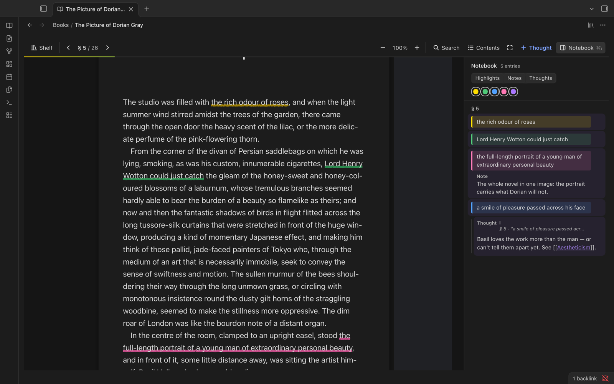
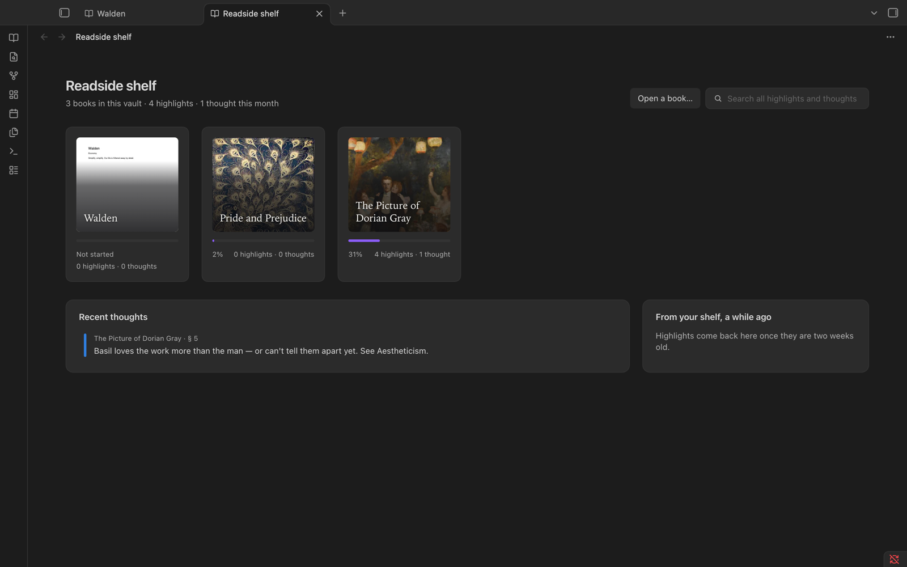

# Readside

A PDF and EPUB reader for Obsidian (desktop only): highlights, pencil underlines, margin notes and
threads, a notebook panel, page navigation, zoom, search and contents, and offline translation. Each
book's notebook is also kept as a Markdown note in your vault, with links back to the page.

The plugin's id is `readside`. It used to be called Margin (id `margin-reader`); see
[Coming from Margin](#coming-from-margin).





## Install

**Back up first.** Before installing, back up the vault, or at least its config folder (`.obsidian`).
Requires Obsidian 1.15.0 or later, desktop (Windows, macOS, Linux).

### From Community plugins

Once the plugin is listed: Settings → Community plugins → Browse, search for "Readside", Install,
then Enable.

### With BRAT (beta)

1. Install and enable the [BRAT](https://github.com/TfTHacker/obsidian42-brat) plugin.
2. BRAT → "Add beta plugin", enter `bilskyi/obsidian-readside`, pick the latest version.
3. Enable Readside under Settings → Community plugins.

### Manually

Download `main.js`, `manifest.json` and `styles.css` from the latest
[release](https://github.com/bilskyi/obsidian-readside/releases) (or build them, see
[Build](#build)) and copy (not link) them into:

```
<vault>/.obsidian/plugins/readside/main.js
<vault>/.obsidian/plugins/readside/styles.css
<vault>/.obsidian/plugins/readside/manifest.json
```

Your vault's config folder may have another name; use the one Obsidian reports. Enable Readside
under Community plugins.

To update by hand, replace only `main.js`, `styles.css` and `manifest.json`, then toggle the plugin off
and on (or reload Obsidian). Never delete or replace the `readside` folder itself: your data lives
in it.

> **Uninstalling Readside deletes all of its data.** Obsidian's "Uninstall" (Settings, Community plugins)
> removes the whole plugin folder `<vault>/.obsidian/plugins/readside/`, and with it `books/`,
> `backups/`, `index.json` and `mirrors.json`: every highlight, note and thought, permanently. To stop
> using Readside, **disable** it instead. If you must uninstall, first copy `books/` and `backups/` out of
> that folder. The `Readside/` notebook notes stay in the vault, but Readside cannot import them back.

## Coming from Margin

Readside was called Margin, with the id `margin-reader`. The new id gives it a new plugin folder, so:

- **Turn Margin off first.** Both register the same view types, so they cannot run side by side;
  disable (do not yet uninstall) Margin, then enable Readside.

- **Your data comes across once.** The first time Readside loads, if its folder
  (`<configDir>/plugins/readside/`) has no `index.json` yet and `<configDir>/plugins/margin-reader/` has
  one, it copies everything there except `main.js`, `manifest.json` and `styles.css` (books, index,
  backups, covers, mirrors.json, settings, downloaded translation files) and says "Readside: imported your
  books and notes from Margin." The old folder is left as it is; uninstall the old plugin yourself once
  you are happy (that deletes `margin-reader/`, not Readside's copy). An interrupted import starts again from scratch on the next load.
- **Notebook notes stay where they are.** An install with notes on record keeps its `Margin/` folder
  (or whatever folder you chose). New installs use `Readside/`.
- **Old links keep working.** `obsidian://margin?file=…&loc=…` links open the book just like
  `obsidian://readside?…`, and count as backlinks. New links, and notebook notes when they are next
  rewritten, use `obsidian://readside`.
- **Unchanged on purpose:** the view types (`margin-reader`, `margin-shelf`), so open tabs in
  workspace.json come back; the notebook notes' `margin-book` and `margin-progress` properties and their
  `margin` tag; the CSS classes (`.margin-app`); the data file formats; command ids.

## Network use

- Readside makes network requests **only to download translation files, and only when you ask**: the
  first time you translate into or out of a language it shows what it will download and its size, and
  downloads nothing until you confirm.
- Every file comes from Mozilla's CDN (`firefox-settings-attachments.cdn.mozilla.net`): the Bergamot
  translation engine and the language models Firefox's built-in translation uses. The URLs, sizes and
  sha256 hashes are fixed in `src/translate/catalog.ts`, and each file is checked against its hash.
- No telemetry, no analytics, no accounts, no update checks of its own.
- Nothing else leaves your device: books, highlights, notes and the text you translate are processed
  locally. Reading, highlighting and the notebook work fully offline.

## Privacy

Readside stores everything in your vault (see [Where your data lives](#where-your-data-lives)) and sends
nothing about you or your books anywhere. The translation downloads are plain file requests, so
Mozilla's CDN sees your IP address like any download.

## Opening PDFs

Readside does not take over PDFs unless you ask it to. The setting "Open PDFs in Readside" is **off by
default**: PDFs keep opening in Obsidian's own viewer, and you open one in Readside from the file menu,
the command palette or the shelf. EPUBs have no viewer in Obsidian, so they open in Readside.

## Build

For development; users install a release (see [Install](#install)).

```
pnpm install
pnpm build:obsidian        # type-checks, then writes obsidian/dist/{main.js,styles.css}
pnpm dev:obsidian          # rebuild on change
pnpm test:obsidian         # plugin tests (jsdom, mocked obsidian)
```

`main.js` has a size budget of 1.5 MiB; the build fails above it. Nothing under `obsidian/dist/` is committed.

## Try it in the test vault

```
pnpm setup:obsidian-vault
pnpm build:obsidian
```

`setup:obsidian-vault` prepares `obsidian/test-vault` only: it writes `Books/Walden.pdf` (three pages, with
an outline) and links `obsidian/test-vault/.obsidian/plugins/readside/{main.js,styles.css,manifest.json}`
to `obsidian/dist`. It is safe to rerun and never touches any other vault.

Then in Obsidian: Open folder as vault, pick `obsidian/test-vault`, Settings, Community plugins, turn off
Restricted mode, enable Readside. Right-click `Books/Walden.pdf`, Open in Readside.

For EPUB samples run `pnpm setup:obsidian-vault -- --epub`: it downloads *Pride and Prejudice* (Project
Gutenberg) and *The Picture of Dorian Gray* (Standard Ebooks), both public domain, from URLs pinned in the
script and checks size and sha256 before writing them to `Books/` (gitignored; never commit them). Without
the flag nothing is downloaded.

## Opening a book

Books are PDFs and EPUBs.

- The ribbon book icon, "Open Readside shelf": the shelf of your books (with covers), and its "Open a book…"
  picker of the vault's PDFs and EPUBs, recent books first.
- Command "Open current book in Readside" while a PDF or EPUB is the active file.
- Right-click a book in the file explorer: "Open in Readside".
- Right-click a `[[file.pdf]]` or `[[file.epub]]` link in a note: "Open in Readside".
- Setting "Open PDFs in Readside" (off by default): a PDF that opens in Obsidian's viewer, in the active tab,
  switches to Readside, whether it was opened from the explorer, the quick switcher or a link. It also fires
  when an existing PDF tab is activated or restored. Other tabs and windows are left alone. A `#page=N` in
  the link is honoured. EPUBs have no Obsidian viewer, so they always open in Readside.
- With the setting off, PDFs open in Obsidian's viewer when opened from a non-Readside tab. A PDF opened
  while a Readside tab is the active tab loads in that Readside tab.
- Links `obsidian://readside?file=<vault path>&loc=<location>` open the book and always jump there and flash.
  The notebook note's links use this form. These links carry the book's vault path, so they break if
  the book is renamed or moved outside Obsidian (in Finder, say).

## EPUB

- Supported: reflowable EPUB 2 and 3 as one continuous column (sections in reading order, images loaded as
  they near), contents from the book's navigation, highlights, notes and thoughts, margin notes, focus
  mode, search across sections, zoom, internal links and footnotes, copy links, the notebook note and
  shelf covers.
- Not supported: paged mode, fixed-layout books, DRM-protected books (each gives a clear error), publisher
  colours (the theme decides), and footnote pop-ups (a footnote link jumps to the note). Publisher fonts
  embedded in the book are used (renamed per book; obfuscated fonts are left out).
- Limits: a book with more than 5,000 sections is refused; a file listed twice in the spine is one
  section. A very large book shows what fits a per-book work budget and notes where a section was cut.
  Images too large to decode safely (over 40 megapixels, an unreadable header, or an SVG over 2 MB) show
  their alt text instead.
- Security: the book is untrusted. Its markup is sanitised (no scripts, event handlers, remote loads or
  embeds), its images come from the file itself, and the mirror notes escape book text so it can never act
  as Markdown or HTML in your vault.

## Links between notes and books

- **Backlinks in the margin.** Notes that link into the open book show as a small "↩ 2" chip in the margin
  at the linked place: Readside's own links (`obsidian://readside?file=…&loc=…`, from Copy Link) at their exact
  spot, and page links (`[[Book.pdf#page=42]]`, `[x](Book.pdf#page=42)`) at the top of the page. Click the
  chip for the list of notes, each with the line that holds its link; click one to open it in a split
  beside the reader (the same split is reused; ⌘-click or a middle click: a new tab). With Page preview
  on, ⌘-hovering a note in the list previews it. The notebook's header says how many notes link here.
  Readside's own notebook notes (anything with `margin-book` in its frontmatter) never count. Page links come
  from Obsidian's metadata cache; Readside links are found by reading each note once (the 5000 most recently
  changed notes, none over 512 KB), then kept up to date from Obsidian's change events.
- **`[[` in a thought.** Typing `[[` in a thought lists the vault's notes; arrow keys move, Enter, Tab (or
  a click) inserts `[[Note name]]`, Escape closes the list. A note whose name contains `#`, `|`, `^`, `[`
  or `]` is inserted as a Markdown link, `[Name](<path/Name.md>)`. The link goes into the notebook note as
  written.

## Commands and keys

Commands (each acts on the active Readside tab). The key column lists the keys the Readside view itself
handles while its tab is active; they are not entries under Settings, Hotkeys, which has no defaults
for Readside. Bind any command there if you want a global hotkey:

| Command | Id | In-view key (macOS) |
| --- | --- | --- |
| Open current book in Readside | `open-current-pdf` | none |
| Add thought at reading line | `new-thought` | ⌘⇧M |
| Toggle notebook | `toggle-notebook` | ⌘\ |
| Toggle contents | `toggle-contents` | ⌘⇧C |
| Find in book | `find` | ⌘F |
| Zoom in / out / to fit width | `zoom-in`, `zoom-out`, `zoom-fit` | ⌘+ / ⌘− / ⌘0 |
| Next / previous page | `next-page`, `prev-page` | PageDown, ⌥→ / PageUp, ⌥← |

The reader's keys are registered on the view's own key scope, so they work whenever the Readside tab is
active, wherever focus is inside it. The ⌘ chords exist on macOS only; on Windows and Linux use the
commands above and bind them yourself. Page keys (PageUp/PageDown, ⌥←/⌥→) work on every platform when
focus is in the page area. Typing in a text field keeps its own keys.

## Settings

- **Notebook notes** (default on): keep a Markdown note of each book's highlights and thoughts.
- **Notebook notes folder** (default `Readside`, or `Margin` for an install from before the rename; empty = vault root). Not a dot-folder, not the config folder.
  Applied after a pause or when the field loses focus; moving it rewrites the notes there.
- **Open PDFs in Readside** (default off), see above.
- **Translation**: the language Translate turns text into, the ⌥-hover toggle, and the downloaded
  language pairs with Remove and Remove all. See [Translation](#translation).

## Where your data lives

Inside the plugin folder `<configDir>/plugins/readside/`:

- `books/<bookId>.json`: highlights, underlines, notes and thoughts of one book
- `index.json`: which vault path is which book (renames and moves are followed; a deleted PDF's book is kept, marked missing; a PDF moved while Readside was off or Obsidian was closed finds its book again by content when opened, while a copy gets a new book)
- `backups/<bookId>-<yyyy-mm-dd>.json`: at most 7 per book, written on the first save each day
- `mirrors.json`: what Readside last wrote into each notebook note
- `data.json`: settings
- `translation/`: the translation engine and language pairs you downloaded (see [Translation](#translation))

Writes go through a temporary file and a rename. Unloading the plugin waits for pending saves (a plugin
update waits for the old instance, at most 5 s), and quitting flushes the store and the notebook notes.

If something was damaged, Readside says so in a notice that stays until dismissed: a book file kept aside
(no backup), a book restored from a backup, or the index rebuilt from the book files. The damaged copy is
never deleted. A write that was cut short after its new copy was complete is finished at the next start;
the copy it replaced is kept as `<file>.prev-<time>`.

## The notebook note

`<folder>/<book title or file name>.md` holds the notebook: general notes, then one section per outline
entry, then unanchored highlights, each with a link back to the page. It is rewritten about 1.5 s after the
last change, on closing the book and on unload, but only when the generated content actually changed.
Reading further alone does not count: the `margin-progress` property catches up on the next real change.
If the note is open with unsaved edits when Readside rewrites it, Obsidian merges and shows a "file changed"
notice.
Readside owns this note. If you edit it, your edit is first copied to `<name> (edited <date time>).md`
beside it, and only when Readside has something new to write. Edit thoughts in Readside, not in the note.

## Translation

Readside translates on your computer. Select text and press **L** (or click Translate in the selection
popover) for a card with the translation. Hold **⌥** (Alt on Windows and Linux) and rest the pointer on a
word of the page for a small tooltip with that word's translation.

- **First use downloads.** The first translation into or out of a language asks before downloading
  anything and shows the size. It needs the translation engine once (about 5 MB, shared by every pair) and
  one model per direction: Ukrainian → English is about 22 MB, English → Ukrainian about 36 MB, and other
  pairs are between about 21 and 70 MB. A pair without English on either side, such as Ukrainian →
  German, goes through English, so it needs both legs and the offer lists both.
- **Where it comes from.** Every file is a fixed Mozilla Remote Settings attachment on
  `firefox-settings-attachments.cdn.mozilla.net`, the same engine and models Firefox's built-in
  translation uses. The exact URLs, sizes and sha256 hashes are listed in `src/translate/catalog.ts`;
  Readside never reads Mozilla's lists at run time. Each file is checked against its sha256 before it is
  used. A file that doesn't match is deleted and the download fails.
- **Where it is stored.** In `<configDir>/plugins/readside/translation/`: `engine/` holds the
  engine, `models/<from>-<to>/<version>/` each pair, and `installed.json` lists what finished downloading.
  An unfinished download leaves files ending in `.part`. They are removed when you cancel, and anything
  left over is tidied about 10 s after the next start.
- **Removing.** Settings → Translation lists the downloaded pairs with their sizes. Remove deletes one
  pair; the engine goes with the last pair. Remove all asks for a second click, then deletes every pair and
  the engine. Remove is unavailable for a pair a running download needs, and Remove all while any
  download runs. A removed pair is offered again the next time
  you translate it. Uninstalling the plugin also deletes them (with the rest of the plugin folder).
- **Privacy.** No text you translate leaves your computer. The downloads are the only network use, and
  they send nothing about your books: they are plain file requests to Mozilla's CDN, which sees your IP
  address like any download.
- **⌥-hover** works only for a pair you have already downloaded; it never starts a download. For a pair
  you haven't, the tooltip says "Select text and press L to set up …". While that pair is downloading,
  or when Readside has no model for it, the tooltip stays away. Turn it off with "⌥-hover translates words"
  in Settings → Translation.

### Translation licences

- **Translation engine** (the Bergamot translator wasm), **its JavaScript glue** (bundled in `main.js`,
  with its MPL header kept) and **the language models**: Mozilla Public License 2.0,
  https://mozilla.org/MPL/2.0/. They are used unmodified. MPL-2.0 is file-level: it puts no obligation
  on Readside's own code.
  - Engine source: https://github.com/mozilla/translations (release v0.6.0, revision
    `1de4a085d3a7afb625c51a60aabb5ad298e4059f`).
  - Glue, as Firefox vendors it:
    https://github.com/mozilla/firefox/blob/2c8de06acae0a9edcbd1e0e49f951a0cbfe427a2/toolkit/components/translations/bergamot-translator/bergamot-translator.js
    (details in `obsidian/src/translate/vendor/VENDOR.md`).
  - Models: the files Mozilla publishes in Remote Settings (`translations-models`), licensed MPL-2.0 per
    the archived https://github.com/mozilla/firefox-translations-models repository they moved out of.
    No per-model licence card was found.
- **Language detection**: franc-min, MIT, https://github.com/wooorm/franc.

## Known limits

- Desktop only (`isDesktopOnly`); PDFs and EPUBs.
- Uses Obsidian's own pdf.js; it is not bundled.
- Syncing `books/` between devices is whatever your vault sync does; two devices writing the same book
  at once are not merged.
- It has not been exercised in real Obsidian by the automated tests: see MANUAL-CHECKLIST.md.
- Translation:
  - ⌥-hover can pick up part of a word. Some PDFs put each glyph (or a few) in its own text span, and
    hover looks at one span; a word split by a line-end hyphen is two words.
  - The page language is guessed with franc-min, which doesn't know Afrikaans, Albanian, Basque, Catalan,
    Danish, Estonian, Finnish, Galician, Hebrew, Icelandic, Latvian, Lithuanian, Norwegian Bokmål,
    Slovak, Slovenian or Uyghur, and can't tell Simplified from Traditional Chinese. For those, pick the
    source in the card's More → From. ⌥-hover shows nothing on such pages. Short selections are guessed
    together with the text around them.
  - Ukrainian → English uses Mozilla's small ("tiny") model, so its translations are rougher than
    English → Ukrainian's.
  - With two models loaded (a card in one direction, then the other, or a pivot pair) the engine uses
    about 300 MB of memory. Readside keeps at most two models loaded and stops the engine after 5 minutes without a translation.
  - Downloaded files are checked by size at each start, by sha256 only when downloaded. A truncated
    file makes the pair download again; a damaged file of the right size is not noticed.
  - Disk: about 5 MB for the engine plus 21–70 MB per pair (22 MB for Ukrainian → English, 36 MB for
    English → Ukrainian).

## License

Readside is released under the [MIT License](LICENSE), copyright 2026 bilskyi.

Third-party code bundled in `main.js` keeps its own licence; see [THIRD_PARTY_NOTICES](THIRD_PARTY_NOTICES)
for the full list. In short:

- The Bergamot translator JavaScript glue (`obsidian/src/translate/vendor/bergamot-translator.js`) is
  Mozilla Public License 2.0, unmodified, with its MPL header kept in `main.js`. Source:
  https://github.com/mozilla/firefox/blob/2c8de06acae0a9edcbd1e0e49f951a0cbfe427a2/toolkit/components/translations/bergamot-translator/bergamot-translator.js
  (engine: https://github.com/mozilla/translations). The engine wasm and the language models are not
  part of this repository or of `main.js`; they are downloaded on request and are MPL-2.0 too.
- React and React DOM, `@codemirror/lang-markdown` and its Lezer parsers, franc-min, fflate: MIT.
- pdf.js is not bundled: Readside uses the copy that ships with Obsidian.
